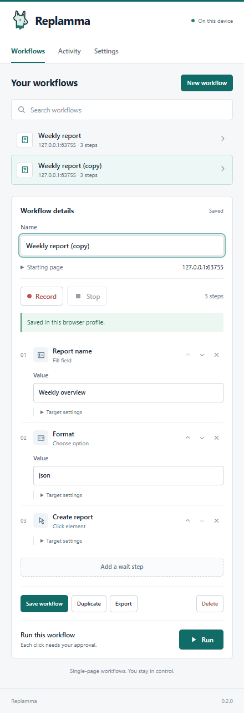

<p></p>

# Replamma

A local browser workflow recorder for desktop Chrome. Record a task, review its steps, and run it again with fresh inputs.

**Version 0.2.0 · Chrome 116+ · No account or backend**

This repository is public and distributed under the MIT license. The previously released Replay 0.1 code remains part of its history. Existing workflow JSON and local workflow storage remain compatible.

## Install

1. Download and extract the extension package from the repository's releases, or use the source folder.
2. Open `chrome://extensions` and turn on **Developer mode**.
3. Select **Load unpacked**, then the folder containing `manifest.json` — `extension/` when using the source.
4. Pin Replamma in Chrome's Extensions menu.
5. Open a normal HTTP(S) page and click Replamma's toolbar icon to grant temporary access.
6. Choose **New workflow**, enter a name, and press **Record**. Perform your task, then **Stop** and **Save workflow**.
7. Reset the page before running it. Each replayed click waits for your approval.

Replamma supports the main document on a single page. Keep the side panel open during recording and playback. Reload the extension and the target page after an update. Chrome may assign a new extension ID when loading from a different directory; export important workflows before switching directories.

While editing a workflow, press **Ctrl+S** (or **⌘S** on macOS) to save. The shortcut is inactive during recording, playback and target selection.

## Interface



The panel opens with your workflow library. Search by name or website, open an existing workflow, or duplicate it to create a variation. Technical selectors are tucked into **Target settings**; ordinary input values remain directly editable.

## Features

| Feature                 | What it does                                                                                                                   |
| ----------------------- | ------------------------------------------------------------------------------------------------------------------------------ |
| Record and edit         | Capture actionable clicks, native text fields and single-choice selects. Reorder, remove and edit steps.                       |
| Visual target selection | Open **Target settings → Choose on page**, then click a replacement target. The selected click is intercepted. Escape cancels. |
| Input variables         | Put `{{report}}` into a step value. Supply a fresh value before running; the template stays unchanged.                         |
| Local activity          | Inspect the latest 50 run outcomes, durations and completed-step counts. Clear them in Activity.                               |
| Search and duplicate    | Find a saved workflow by name or host and create a variation without replacing the original.                                   |
| Approval and stop       | Every replayed click requires approval. Stop cancels playback, pending target lookup and picker mode.                          |
| JSON files              | Import validated version-1 workflows through **Settings → Import JSON**. Export from the editor.                               |
| Local storage           | No account, telemetry, remote scripts, model provider or developer-operated service.                                           |

Run inputs are not saved to workflow files or activity. Concrete values captured while recording are saved as part of the workflow, so review them. Activity stores the workflow name, time, outcome, counts and duration; it does not store URLs, selectors, resolved values or error text.

## Try it locally

With Node.js 22 or newer:

```sh
npm run demo
```

Open **http://127.0.0.1:4173**, click the Replamma toolbar icon and record entering a report name, choosing a format and clicking **Create report**. Stop and save. Reload the playground and run the workflow. The local demo does not send form data anywhere.

To try variables, change the report-name step's value to `{{report}}`. Fill **Inputs for this run → report**, then run it. The saved workflow retains its placeholder.

## Permissions and privacy

Replamma requests `activeTab`, `scripting`, `storage`, and `sidePanel`. It does not request persistent host permissions, history or cookies. Chrome grants temporary access when you invoke the extension. See [Chrome's activeTab documentation](https://developer.chrome.com/docs/extensions/develop/concepts/activeTab).

- Storage stays in the current browser profile and is not encrypted by Replamma.
- Passwords, recognizable sensitive field names and elements inside `[data-replay-private]` are excluded by a heuristic, not a general personal-data detector.
- The website can observe entered values and make its own network requests. Click approval does not sandbox those effects.
- Imported workflows cannot contain executable actions, but selectors and values still require inspection.
- Interface labels cannot normally be selected and copied. Editable fields retain standard selection. This is an interaction choice, not DRM or a guarantee against inspecting installed JavaScript.
- Repository privacy restricts who can access the hosted source. It cannot recall previously distributed copies or prevent extraction from an installed browser extension.

Read [Privacy](docs/PRIVACY.md) and [Security](SECURITY.md) before using real data.

## Current limits

One HTTP(S) page, top-level DOM, at most 250 steps. The run is bound to its starting origin, path and query; URL fragments may change during replay. Capture stops if the URL changes, including its fragment. Navigation destroys in-memory capture, so the final polling interval may be lost.

Recording expires after two seconds without a panel heartbeat. A suspended panel can therefore end capture. The picker expires after 30 seconds. Closing the panel interrupts playback.

Not supported: cross-page workflows, popups, iframes, shadow DOM, contenteditable, uploads, keyboard shortcuts, drag-and-drop, native multi-selects, extraction, loops, scheduling or AI editing. Some sites reject synthetic playback events. Downloads rely on the site's own click behavior.

## Development

The extension has no runtime dependencies and needs no build step. Test tooling uses npm:

```sh
npm ci
npm run format:check
npm run check
npm test
npx playwright install chromium
npm run test:e2e
npm run package
```

The package script writes an unpacked extension to `dist/replamma/`. Use `npm run icons` to render the toolbar PNGs from the original SVG llama mark.

Integration tests use an isolated Chromium profile and a temporary manifest that grants loopback access; this lets tests exercise extension APIs without a physical toolbar click. The shipped manifest has no host permissions. Manual validation of the real toolbar and side-panel permission flow remains necessary.

## Documentation

[Architecture](docs/ARCHITECTURE.md) · [Workflow format](docs/WORKFLOWS.md) · [Design notes](docs/DESIGN.md) · [Roadmap](docs/ROADMAP.md) · [Contributing](CONTRIBUTING.md) · [Changelog](CHANGELOG.md)

The MIT source license is retained in [LICENSE](LICENSE). Repository privacy and license rights are separate. The Replamma mark is original; no affiliation with Ollama, Google, Adblock Plus or Malwarebytes is implied.
