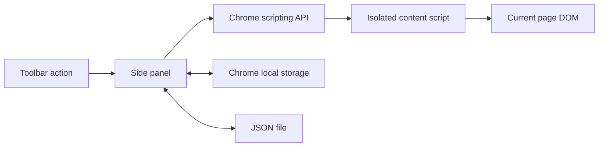

# Architecture

`background.js` configures the toolbar action to open the side panel and restricts storage access to trusted extension contexts on installation. The service worker does not orchestrate long-running jobs.

`panel.js` owns the editor, workflow library and sequential run loop. Each run captures an immutable validated plan and the target tab ID. Changing the active tab does not retarget a run. A generation token cancels the panel loop; `CANCEL` also invalidates pending content-script lookups.

`content.js` is injected only after explicit user interaction grants temporary access. Injection is idempotent. It records trusted DOM events in the top frame, coalesces adjacent updates to the same input, and keeps a bounded in-memory recording. The panel polls every 500 ms and writes a draft locally. Capture expires after two seconds without this heartbeat, so a closed or suspended panel cannot record indefinitely. A session ID distinguishes a recording from a new page instance. Full navigation destroys in-memory capture; the last polled draft survives.

Selectors prefer unique `data-testid`, `id`, `name`, and `aria-label` attributes, then fall back to a structural `nth-of-type` path. Playback rejects multiple matches rather than guessing. Each non-wait step validates the current URL, resolves a target with a five-second deadline, blocks sensitive fields and hidden/disabled targets, then dispatches a click or native value setter with input/change events.

`core.js` contains the allowlisted workflow schema and URL checks, shared between the panel, injected script, and tests. Import normalization strips unknown fields. There is no executable expression or scripting action in the format.

## Constraints and tradeoffs

- The side panel must remain open during a run. No service-worker keepalive tricks are used.
- Recording polls are not an event journal. The final 500 ms can be lost if the page navigates.
- Structural selectors are intentionally inspectable but can break after layout changes.
- Synthetic events are rejected by some sites; trusted-event emulation is not attempted.
- Approval covers clicks only. Input changes may trigger site behavior immediately.
- Multi-page orchestration needs a persistent state machine and a clear permission model before implementation.
